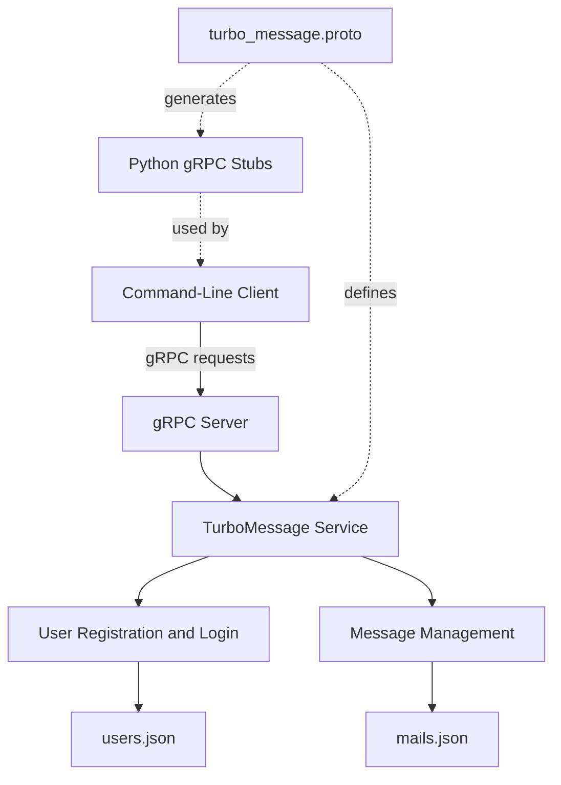

# TurboMessage — Distributed Messaging System

A Python-based distributed messaging application built with **gRPC and Protocol Buffers**, featuring user registration, authentication, message delivery, inbox and outbox management, and JSON-based persistence.

## Overview

TurboMessage is a client-server application that simulates a simplified email system. It demonstrates how distributed application components communicate through remote procedure calls (RPC) and how a server can manage user accounts and messages across multiple client sessions.

The client provides an interactive command-line interface, while the server implements the messaging operations, manages application state, and persists data locally in JSON files.

This project explores distributed systems concepts, service contracts, concurrent request handling, and file-based persistence.

## Features

- **User registration and login:** Create accounts with unique usernames and authenticate with credentials.
- **Message delivery:** Send messages to registered recipients, including a subject and message body.
- **Inbox and outbox:** View received and sent messages.
- **Message reading:** Retrieve a message by ID and mark received messages as read.
- **Message deletion:** Delete messages from the inbox or outbox.
- **Persistent storage:** Store user accounts and messages in JSON files.
- **RPC-based communication:** Define and expose service operations using gRPC and Protocol Buffers.
- **Concurrent request handling:** Process RPC calls through a thread pool.
- **Shared-state protection:** Use a thread lock to coordinate access to shared JSON-backed application data.
- **Mailbox limits:** Enforce a maximum of five messages per inbox and outbox.

## Technology Stack

| Technology | Purpose |
|---|---|
| Python 3 | Application logic and client-server implementation |
| gRPC | Remote procedure calls between client and server |
| Protocol Buffers | Service contracts and structured message serialization |
| JSON | Local persistence of users and messages |
| `ThreadPoolExecutor` | Concurrent RPC request handling |
| `threading.Lock` | Coordination of shared file operations |

## Architecture



The application separates the client interface from the server-side business logic. The `.proto` file defines the communication contract, while generated Python modules allow the client to invoke server operations through gRPC.

The server uses JSON files as its persistence layer instead of a relational database.

## RPC Service Definition

The `TurboMessage` service exposes the following operations:

| RPC method | Description |
|---|---|
| `RegisterUser` | Register a new user |
| `Login` | Validate login credentials |
| `SendMail` | Send a message to another registered user |
| `GetInbox` | Retrieve a user's received messages |
| `GetOutbox` | Retrieve a user's sent messages |
| `ReadMail` | Retrieve a message and update its read status |
| `DeleteMail` | Delete a message from a mailbox |

These operations use Protocol Buffers messages to structure request and response data.

## Project Structure

```text
Proyecto-Omega/
├── cliente.py
├── servidor.py
├── turbo_message.proto
├── turbo_message_pb2.py
├── turbo_message_pb2_grpc.py
├── users.json
├── mails.json
├── Manual_Uso.txt
└── README.md
```

- `cliente.py`: Command-line interface and gRPC client.
- `servidor.py`: Server implementation, messaging logic, concurrency, and persistence.
- `turbo_message.proto`: Definitions of RPC methods and message structures.
- `turbo_message_pb2.py`: Generated Protocol Buffers message classes.
- `turbo_message_pb2_grpc.py`: Generated gRPC client and server interfaces.
- `users.json`: Local user-account storage.
- `mails.json`: Local inbox and outbox storage.
- `Manual_Uso.txt`: Additional usage instructions.

**Note:** The JSON files may contain local test data. Do not publish real credentials or private messages. Use empty files or sanitized sample data when sharing the repository.

## Getting Started

### Prerequisites

- Python 3.
- `pip` for installing Python packages.

### 1. Clone the repository

```bash
git clone https://github.com/jman0306/Proyecto-Omega.git
cd Proyecto-Omega
```

### 2. Create a virtual environment

Windows:

```powershell
python -m venv .venv
.venv\Scripts\Activate.ps1
```

macOS or Linux:

```bash
python3 -m venv .venv
source .venv/bin/activate
```

### 3. Install dependencies

```bash
python -m pip install grpcio grpcio-tools
```

The repository includes generated Python files for the Protocol Buffers definitions. If you modify `turbo_message.proto`, regenerate the Python modules with:

```bash
python -m grpc_tools.protoc -I. --python_out=. --grpc_python_out=. turbo_message.proto
```

### 4. Prepare local data files

Ensure that `users.json` and `mails.json` contain valid JSON objects. For a clean local run, use empty objects:

`users.json`

```json
{}
```

`mails.json`

```json
{}
```

The server also initializes these files if they do not exist.

**Warning:** The application writes to these files while running. Back up any data you want to preserve before resetting them.

### 5. Start the server

Open a terminal in the project directory:

```bash
python servidor.py
```

The server listens on port `50051`.

### 6. Start the client

Open a second terminal, activate the same virtual environment, and run:

```bash
python cliente.py
```

Register a user, sign in, and use the application menu to send, view, read, or delete messages.

For more detailed instructions, see [`Manual_Uso.txt`](Manual_Uso.txt).

## How Message Delivery Works

1. A sender selects the send-message option in the client.
2. The client sends a `SendMail` RPC request containing the sender, recipient, subject, and body.
3. The server checks whether the recipient exists and whether the relevant mailbox limits allow delivery.
4. The server updates the local JSON-backed message data.
5. The client displays the response returned by the server.

Reading a received message retrieves its contents and updates its read status. Messages can also be deleted from the inbox or outbox.

## Engineering Concepts Demonstrated

- Distributed client-server architecture.
- Remote procedure calls using gRPC.
- Interface and message contract definition with Protocol Buffers.
- Concurrent server request handling.
- Synchronization of shared application state.
- File-based persistence and data serialization.
- Request validation and application-level error handling.
- Separation of client interaction and server business logic.

## Limitations and Future Improvements

This project is an educational prototype, not a production-ready email service. Potential improvements include:

- Hashing passwords with a purpose-built password-hashing algorithm instead of storing plaintext passwords.
- Adding TLS to protect credentials and messages in transit.
- Implementing server-side authentication and authorization for every protected RPC.
- Replacing JSON files with a database for stronger transactional guarantees and more scalable data access.
- Improving error handling, input validation, and concurrent file access.
- Adding automated unit and integration tests.
- Implementing structured logging and monitoring.
- Introducing configuration for server addresses, ports, and storage locations.

## Security Notice

The current implementation uses an insecure gRPC channel and stores passwords in plaintext in the JSON persistence layer. It should only be used with test data in a controlled environment until these issues are addressed.

Do not use real passwords or sensitive messages with this prototype.

## Author

**Juan Manuel Ambriz Nuñez**

GitHub: [jman0306](https://github.com/jman0306)
